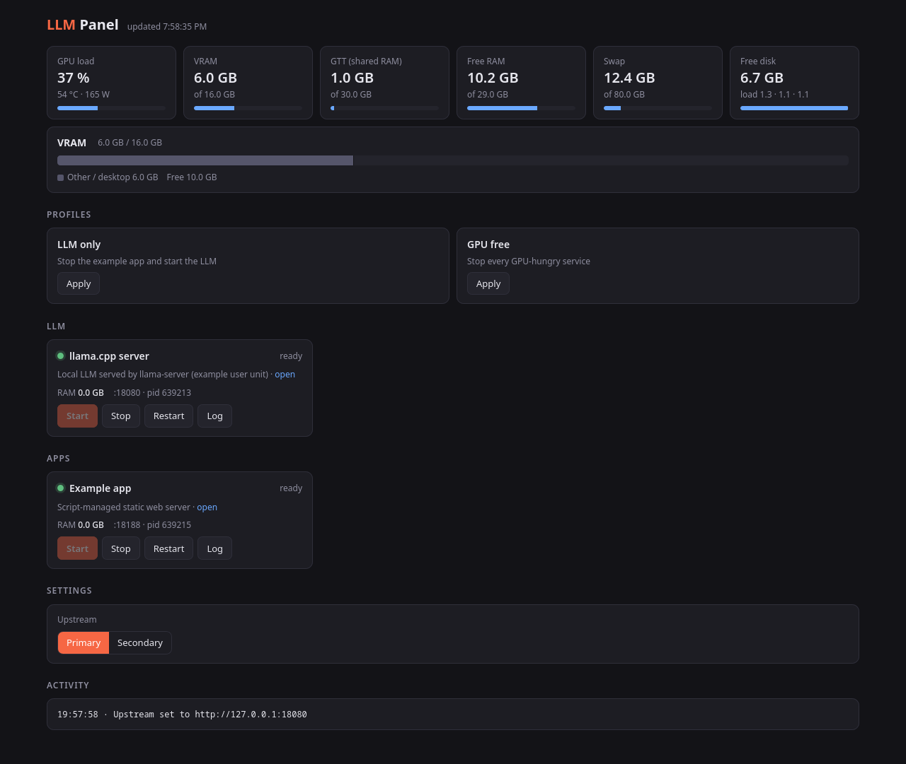

# LLM Panel

A tiny, dependency-free web dashboard for a local LLM box. Start and stop models and companion apps, switch predefined profiles, watch GPU/RAM/VRAM stats, and read service logs from one page.



- One Python file and one HTML file, standard library only
- Config-driven: add any systemd unit, script, or command
- Per-process VRAM from DRM fdinfo (AMD)
- Profile switching, with an optional upstream URL for a companion app
- Logs from journald or plain files

## Requirements

- Linux
- Python 3.9+
- `systemd` + `journalctl` for unit-managed services (optional if you only use scripts)
- `iproute2` (`ss`) to resolve listening PIDs
- AMD GPU sysfs for GPU stats (optional; other hardware simply shows `—`)

## Quick start

```bash
git clone https://github.com/WalidOA27/llm-panel.git
cd llm-panel
cp services.example.json services.json
$EDITOR services.json
python3 panel.py
```

Open <http://127.0.0.1:9400>.

`services.json` is re-read on every request, so edits apply without restarting the panel.

## Configuration

### `services[]`

| Field | Description |
| --- | --- |
| `id` | Unique identifier used by actions and profiles |
| `name`, `desc` | Labels shown in the UI |
| `group` | `llm` or `app` (two sections in the UI) |
| `port` | Local port used for health checks and PID lookup |
| `health` | Optional HTTP path for the health check (default `/health`) |
| `control` | How to start/stop the service (see below) |
| `log` | Where to read logs from (see below) |
| `extra` | Optional extra buttons, e.g. `[{"action":"free","label":"Free VRAM"}]` |

Control types:

```json
{"type": "user-unit", "unit": "llama.service"}
{"type": "system-unit", "unit": "llama"}
{"type": "script", "start": ["bash", "-c", "..."], "stop": ["pkill", "-f", "..."]}
```

- `user-unit` runs `systemctl --user <verb> <unit>`.
- `system-unit` runs `sudo -n /usr/bin/systemctl <verb> <unit>`; add a narrow NOPASSWD sudoers rule.
- `script` runs the `start`/`stop` argv directly (no shell unless you invoke one).

Log types:

```json
{"type": "file", "path": "~/.local/state/llm-panel/app.log"}
{"type": "journal-user", "unit": "llama.service"}
{"type": "journal-system", "unit": "llama"}
```

The `free` extra action sends `POST /free` with `{"unload_models":true,"free_memory":true}` to the service port (llama.cpp/ComfyUI-style endpoint).

### `profiles[]`

A profile is a list of service IDs to `stop`, `free`, and `start`, plus an optional `upstream` URL:

```json
{
  "id": "llm-only",
  "name": "LLM only",
  "desc": "Stop the example app and start the LLM",
  "stop": ["demo-app"],
  "start": ["llama"],
  "upstream": "http://127.0.0.1:8080"
}
```

The `upstream` value is written to `~/.config/llm-panel/upstream`, so another app can read which backend is active.

### `ui`

```json
{
  "upstreams": [{"name": "Primary", "url": "http://127.0.0.1:8080"}],
  "links": {"llama": "http://127.0.0.1:8080"},
  "desktop_gpu": false
}
```

- `upstreams` renders quick-switch buttons that update the upstream file.
- `links` adds an **open** link to a service card when it is ready.
- `desktop_gpu` enables the desktop GPU toggle (requires `LLM_PANEL_IGPU_PCI`).

## Environment variables

| Variable | Default | Purpose |
| --- | --- | --- |
| `LLM_PANEL_PORT` | `9400` | HTTP port (bound to `127.0.0.1`) |
| `LLM_PANEL_CONFIG` | `./services.json` | Config file; falls back to `services.example.json` |
| `LLM_PANEL_STATE` | `~/.local/state/llm-panel` | State directory |
| `LLM_PANEL_CARD` | `/sys/class/drm/card0/device` | AMD GPU sysfs device |
| `LLM_PANEL_DGPU_PDEV` | unset | PCI ID filter for per-process VRAM, e.g. `0000:03:00.0` |
| `LLM_PANEL_UPSTREAM_FILE` | `~/.config/llm-panel/upstream` | File written by profiles/upstream buttons |
| `LLM_PANEL_IGPU_ENV` | `~/.config/environment.d/10-igpu.conf` | Env file used by the desktop GPU toggle |
| `LLM_PANEL_IGPU_PCI` | unset | iGPU PCI ID, e.g. `pci-0000_0f_00_0` |

## Run as a user service

```bash
mkdir -p ~/llm-panel
cp panel.py index.html services.example.json ~/llm-panel/
cp services.example.json ~/llm-panel/services.json
cp llm-panel.service ~/.config/systemd/user/
systemctl --user daemon-reload
systemctl --user enable --now llm-panel
loginctl enable-linger "$USER"   # start without an active session
```

Adjust `WorkingDirectory` and `ExecStart` in the unit if you install it elsewhere.

## Security

The panel binds to `127.0.0.1` on purpose. Its endpoints can start and stop services, run configured commands, and write config-adjacent files. Do **not** expose it to a network or the internet without adding authentication and HTTPS in front of it.

Per-process VRAM is read from `/proc/<pid>/fdinfo`; you can only see processes owned by your user unless the panel runs as root.

## Notes

- GPU statistics rely on AMD sysfs (`mem_info_vram_*`, `gpu_busy_percent`, `hwmon`). On NVIDIA/Intel they are reported as unknown.
- `system-unit` control needs `sudo -n`, i.e. a passwordless rule limited to the exact units you manage.
- The UI polls `/api/status` every 3 seconds.

## Project layout

```
panel.py               HTTP server, config, service and GPU logic
index.html             single-page dashboard
services.example.json  documented example config
llm-panel.service      example systemd user unit
docs/screenshot.png    dashboard preview
```
